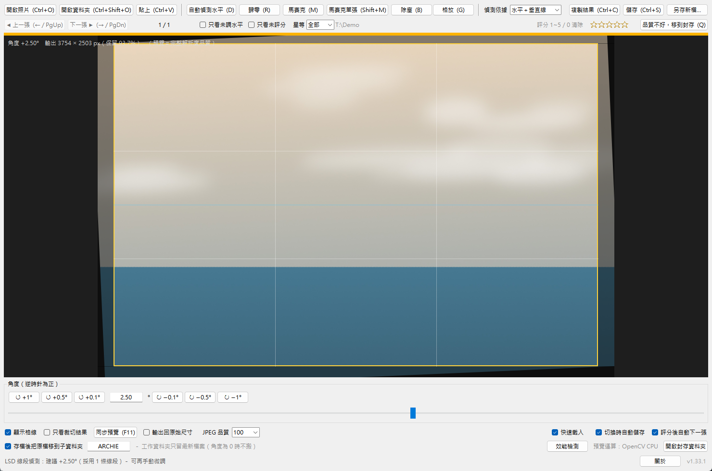

# 照片水平調整（Photo Leveler）

把歪掉的照片快速轉正的小工具，順便幫你挑照片、修感光元件入塵、打馬賽克、裁切放大。
單一執行檔、免安裝、完全免費。

## 下載

**[⬇ 下載最新版 jct-photo-leveler.exe](../../releases/latest/download/jct-photo-leveler.exe)**

下載後直接執行即可，不需要安裝任何其他東西。所有版本見[發布頁面](../../releases)。

## 系統需求

- Windows 10 / 11（64 位元）
- 不需要安裝 Python 或其他軟體

## 快速上手

1. 打開程式，按「開啟資料夾」選到放照片的資料夾
2. 按 `D` 自動偵測水平（或在照片上沿著地平線拖一條參考線）
3. 按 `Ctrl+S` 儲存——成品存成「原檔名_leveled.jpg」，原始檔自動移到 ARCHIE 備份資料夾，照片不會不見

接著按 `→` 看下一張，重複就好。

## 主要功能

| 功能 | 說明 |
|---|---|
| 調整水平 | 自動偵測、按鈕微調、或直接在照片上拉一條「應該是水平」的參考線 |
| 挑選照片 | 按 `1`～`5` 給星等並自動跳下一張；下拉選單只看 3 星以上；`Q` 淘汰 |
| 除塵 | 修補感光元件入塵造成的黑斑：自動偵測＋手動點選，大斑、黑點都有對應做法 |
| 馬賽克 | 對車牌、人臉等區域打馬賽克（含人臉自動偵測） |
| 等比格放 | 用固定比例的框裁切放大，存成新照片、原檔不動 |
| 同步預覽 | 按 `F11` 另開一個乾淨的預覽視窗，可放到第二個螢幕全螢幕檢視 |

## 常用快捷鍵

| 鍵 | 功能 |
|---|---|
| `←` `→` | 上一張／下一張 |
| `D` | 自動偵測水平 |
| `Z` `X` `C` `V` | 微調角度（左逆時針、右順時針） |
| `1`～`5`、`0` | 星等評分／清除 |
| `Q` | 淘汰（移到封存資料夾，`Ctrl+Z` 可復原） |
| `B` / `M` / `G` | 除塵／馬賽克／等比格放 |
| `F11` | 同步預覽視窗 |
| `Ctrl+S` | 儲存 |

程式裡每個按鈕都標了對應的快捷鍵，忘記了看按鈕就好。

## 常見問題

- **第一次開啟很慢？** 單檔版啟動要先自解壓，等幾秒是正常的。
- **Windows 跳出「已保護您的電腦」？** 這是 SmartScreen 對未簽章程式的
  提醒，按「其他資訊」→「仍要執行」即可。
- **原始檔會被改掉嗎？** 不會。所有輸出都是另存新檔，原始檔只會被
  「搬」到同資料夾的 ARCHIE 子資料夾備份，隨時可以拿回來。

## 授權與第三方元件

本程式免費提供使用。內含之開源元件（Python、Tcl/Tk、NumPy、OpenCV、Pillow 等）
授權全文見 [THIRD_PARTY_LICENSES.txt](THIRD_PARTY_LICENSES.txt)，
程式內「關於」視窗也可以直接開啟。
